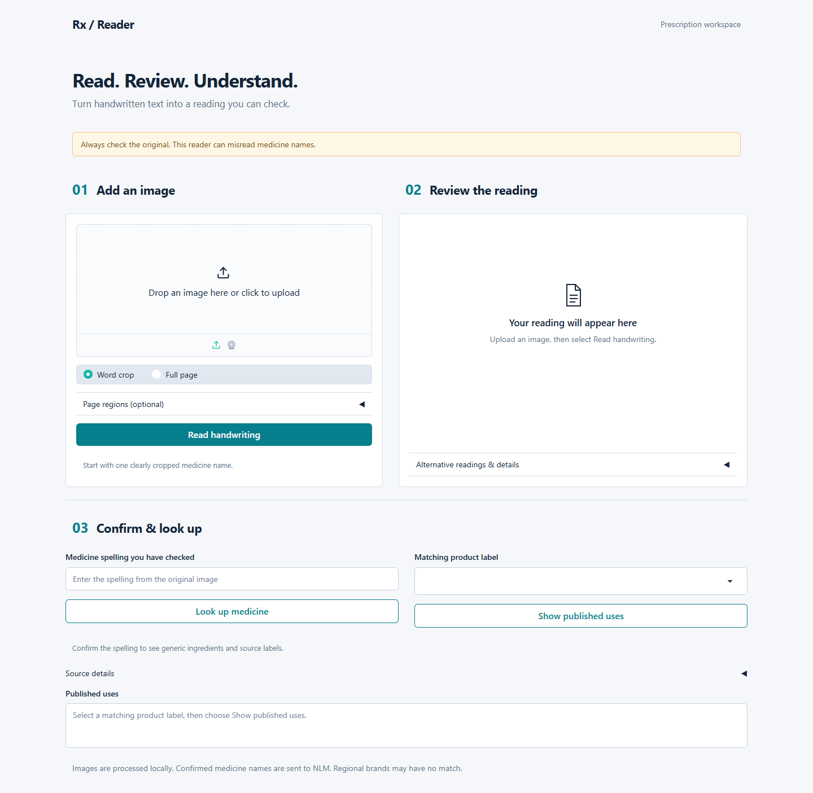

# RxReader — Handwritten Prescription OCR

A Python research prototype for reading handwritten prescription crops, reviewing alternative readings, and retrieving source-backed medicine information after spelling confirmation.

[](https://colab.research.google.com/github/Harshpreet1729/Prescription-Scanner-Medicine-Identifier/blob/main/notebooks/RxHandBD_TrOCR_Base_Colab.ipynb)



## What it does

- Fine-tunes **TrOCR-base-handwritten** on reproducibly prepared RxHandBD word crops.
- Reads individual crops, manually defined page regions, or regions from optional PaddleOCR detection.
- Shows raw readings, alternatives, literal strength/schedule fields, and review status.
- Retrieves generic ingredients through exact RxNorm lookup and published uses from a user-selected DailyMed label.
- Provides a responsive Gradio interface and a self-contained Colab training notebook with live progress, persistent checkpoints, and resume support.

This is **not a clinical decision system**. It can misread medicine names, cannot certify a prescription, and does not recommend doses or treatment. Review every result against the original image.

## Measured results

Normalized metrics ignore case and normalize whitespace; CER is character error rate. Lower CER is better. Exact match means the entire transcription matches.

| Model | Split | Images | CER | Exact match |
|---|---|---:|---:|---:|
| Pretrained TrOCR-small | Validation | 444 | 59.54% | 9.91% |
| Pretrained TrOCR-base | Validation | 444 | 54.39% | 12.16% |
| Fine-tuned TrOCR-base | Validation | 444 | **16.57%** | **48.87%** |
| Fine-tuned TrOCR-base | Held-out test | 1,111 | **28.78%** | **41.22%** |

Fine-tuning reduced validation CER by **72.2% relative to the pretrained small baseline**. This does not establish superiority over a separately fine-tuned small model. Test performance is lower than validation performance; neither split establishes writer independence or full-page accuracy. See [results and limitations](docs/MODEL_CARD.md) and [machine-readable metrics](docs/results.json).

## Run locally

Use Python 3.11 in a fresh environment. From the project root:

```bash
python -m venv .venv
# Windows PowerShell
.venv\Scripts\Activate.ps1
# macOS/Linux: source .venv/bin/activate
python -m pip install -r requirements.txt
python -m app.gradio_app
```

Open **http://127.0.0.1:7860**. A fresh clone uses the public pretrained small checkpoint and downloads it on first inference. **That default does not reproduce the fine-tuned results above.**

For the fine-tuned model, export the complete `best` folder from your completed Colab run, place it under `checkpoints/trocr_base_rxhandbd/best`, and run:

```bash
python -m app.gradio_app --model checkpoints/trocr_base_rxhandbd/best
```

The fine-tuned weights are not distributed in Git. To select a local default, copy `configs/app.example.json` to `configs/app.json` after installing the model. Images stay local in the local app; confirmed medicine names and label IDs are sent to NLM. Local brands may have no exact match.

## Train in Colab

Use the **Open in Colab** button above, select a GPU, and run the cells. The notebook:

1. Downloads the pinned publisher archive and verifies checksums/split hashes.
2. Saves reports and checkpoints to an authorized Google Drive folder.
3. Measures pretrained validation baselines, then fine-tunes TrOCR-base.
4. Shows actual training/validation progress, loss and streamed logs.
5. Compares validation metrics and offers optional held-out testing/model export.

**Run all starts training.** Free Colab GPU availability is not guaranteed. See [Colab instructions](docs/COLAB_TRAINING.md). The notebook only installs dependencies and trains after you run it; opening it alone does neither.

## Data and command-line tools

RxHandBD provides 5,578 original word-crop images. Prepared splits contain 3,994 training, 444 validation and 1,111 test examples; 12 ambiguous/conflicting examples are quarantined and 17 redundant copies excluded from active splits. All source images and transcriptions are preserved locally.

```bash
python -m scripts.download_dataset
python -m scripts.audit_dataset
python -m scripts.train                         # preflight only
python -m scripts.train --config configs/colab_base.json --execute  # requires CUDA
python -m scripts.evaluate --model checkpoints/trocr_base_rxhandbd/best --split validation
python -m scripts.infer --image path/to/crop.jpg --model checkpoints/trocr_base_rxhandbd/best
python -m unittest discover -s tests -v
```

For automatic page detection, install `requirements-page.txt`. See [runbook](docs/RUNBOOK.md), [data provenance](data/rxhandbd/README.md), and [model card](docs/MODEL_CARD.md).

## Structure

```text
app/                  Gradio layout, styles and escaped result presentation
src/prescription/     OCR, region detection, extraction, retrieval and metrics
scripts/              Data preparation, training, evaluation and inference
configs/              Reproducible model settings and local app example
notebooks/            Self-contained Colab training workflow
data/rxhandbd/        Public provenance and frozen split checksums
docs/                 Setup, model limitations, results and UI preview
tests/                Pipeline, progress and presentation regression tests
```

The frontend is currently Gradio. React is a future frontend option; recognition and retrieval already live in separate Python modules. No React frontend or dedicated REST backend is claimed.

## Checks and scope

The current suite contains **25 tests**, including extraction behavior, source retrieval failures, metric calculations, training guards, notebook consistency, cancellation and HTML escaping. Desktop/mobile browser checks cover real OCR, live lookup, result clearing, and layout overflow.

Datasets, trained checkpoints, caches, exports, local experiment logs and personal documents are deliberately excluded from Git. The original implementation remains in repository history; local legacy assets are archived rather than silently deleted.

## Acknowledgments

- [RxHandBD](https://doi.org/10.5281/zenodo.18478741), Md. Masudul Islam; publisher-declared MIT license. See retained publisher metadata for dataset terms.
- [Microsoft TrOCR](https://github.com/microsoft/unilm/tree/master/trocr) and [Hugging Face checkpoint](https://huggingface.co/microsoft/trocr-base-handwritten).
- [PaddleOCR](https://github.com/PaddlePaddle/PaddleOCR), [RxNorm](https://lhncbc.nlm.nih.gov/RxNav/) and [DailyMed](https://dailymed.nlm.nih.gov/).

Third-party data, model weights and services retain their own licenses and terms. Public source availability does not establish clinical suitability.
